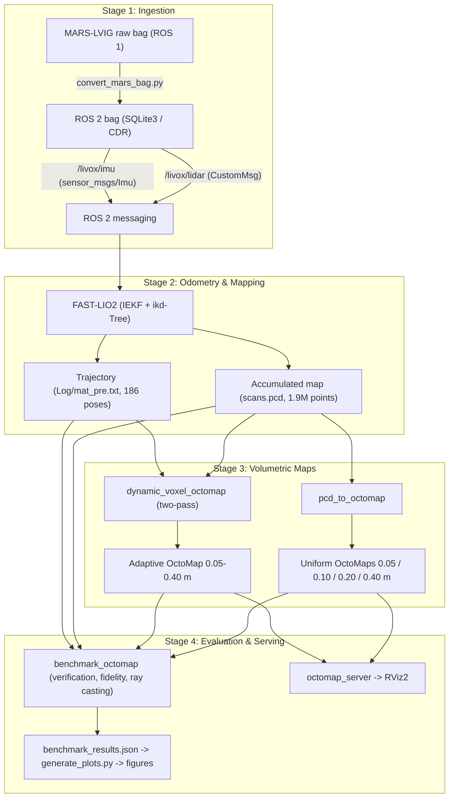
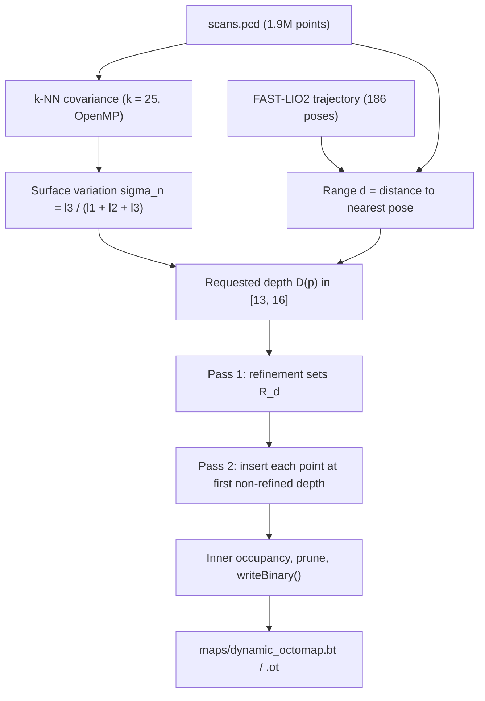
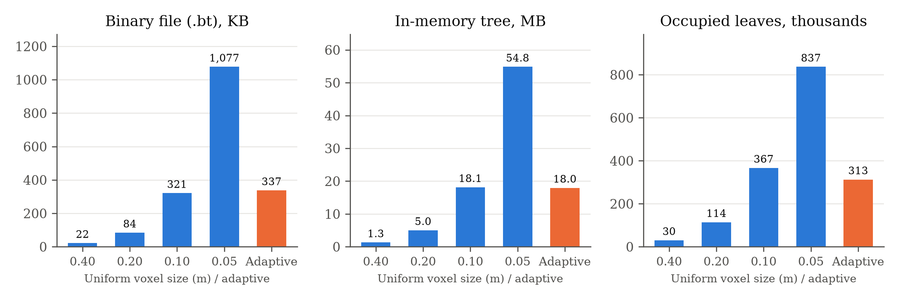
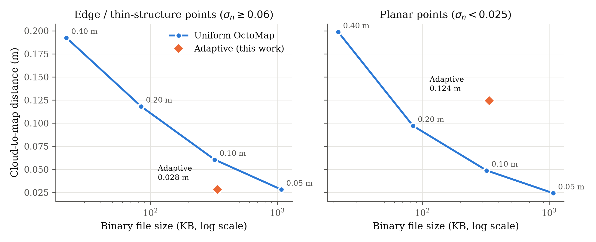
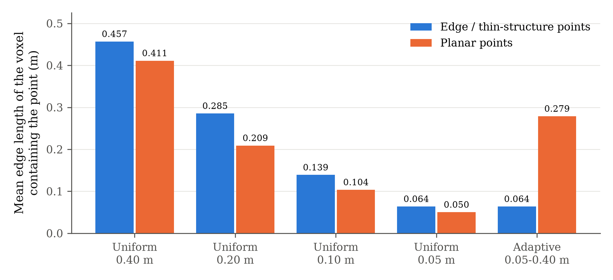
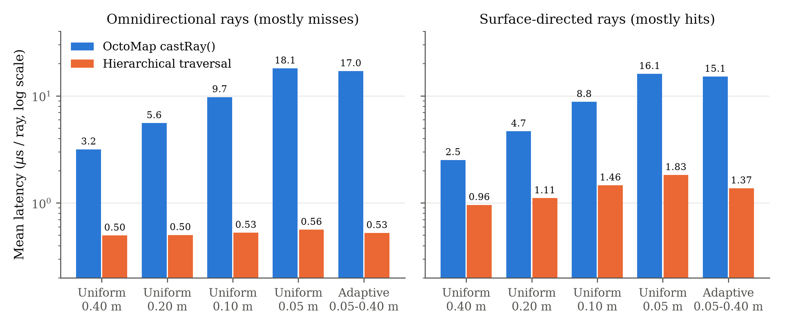
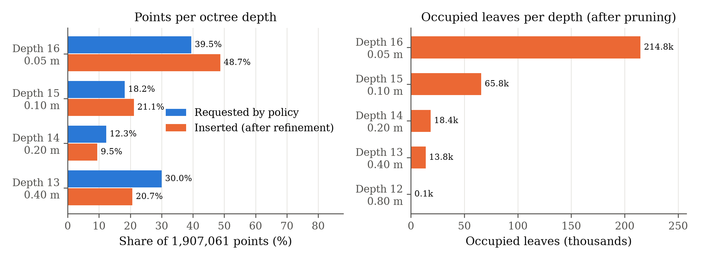

# BTP-I Technical Report: 3D Environment Reconstruction Using UAV LiDAR Data

---

**Project Title:** 3D Environment Reconstruction using UAV LiDAR Data
**Degree / Academic Level:** Bachelor of Technology Project (BTP-I)
**Academic Session:** Autumn Semester 2026–27
**Department:** Department of Industrial and Systems Engineering
**Institution:** Indian Institute of Technology Kharagpur (IIT KGP)
**Student Name:** Shaurya Baranwal (Roll No.: 23IM10052)
**Project Supervisor:** Prof. Subhajit Sidhanta
**Code Repository:** `/home/shaurya/BTP_UAV_LiDAR_Reconstruction`
**Target Environment:** ROS 2 Jazzy Jalisco (Ubuntu 24.04 LTS / Linux x86_64)

**Scope:** raw UAV LiDAR-IMU logs → ROS 2 → FAST-LIO2 odometry and map → uniform OctoMaps → **Dynamic Voxel Gridding (adaptive-resolution OctoMap)**, with benchmarking and verification. Terrain modelling and field flights are outside the scope of this project phase.

All numbers in Sections 6–9 are produced by the scripts in this repository; raw logs and JSON results are in [`Reports/benchmark/`](benchmark/).

---

## Table of Contents
1. [Executive Summary](#1-executive-summary)
2. [End-to-End System Architecture](#2-end-to-end-system-architecture)
3. [Sensor Specifications & Experimental Dataset](#3-sensor-specifications--experimental-dataset)
4. [Data Ingestion & ROS 1 to ROS 2 Migration](#4-data-ingestion--ros-1-to-ros-2-migration)
5. [State Estimation & Odometry: FAST-LIO2](#5-state-estimation--odometry-fast-lio2)
6. [Uniform OctoMap Representation](#6-uniform-octomap-representation)
7. [Dynamic Voxel Gridding: Method](#7-dynamic-voxel-gridding-method)
8. [Dynamic Voxel Gridding: Results](#8-dynamic-voxel-gridding-results)
9. [ROS 2 Runtime Infrastructure & Verification](#9-ros-2-runtime-infrastructure--verification)
10. [Project Status & Limitations](#10-project-status--limitations)
11. [Reproducing the Results](#11-reproducing-the-results)
12. [Summary Table of Artifacts](#12-summary-table-of-artifacts)

---

## 1. Executive Summary

UAVs carrying LiDAR can digitise large environments quickly, but turning a high-rate, non-uniform solid-state LiDAR stream into a compact, query-efficient map is hard:
1. **Non-uniform sampling:** the Livox Avia's non-repetitive pattern and range-dependent point density produce dense near-field and sparse far-field returns.
2. **Aggressive motion:** intra-scan motion must be compensated with tightly-coupled inertial estimation.
3. **Uniform voxel grids scale badly:** a fine grid (0.05 m) is large everywhere, while a coarse grid (0.40 m) merges thin structures into large voxels.

### Completed work
- **ROS 1 → ROS 2 conversion** of MARS-LVIG Livox logs (`scripts/convert_mars_bag.py`). The 20 s test slice holds 201 LiDAR scans and 4,165 IMU messages; the first 169 scans of the source bag (invalid start-up returns) are intentionally discarded.
- **FAST-LIO2 under ROS 2 Jazzy**, producing a 186-pose trajectory and an accumulated map of **1,907,061 points** (`scans.pcd`, 59 MB).
- **Uniform OctoMaps** at 0.05, 0.10, 0.20 and 0.40 m (`scripts/pcd_to_octomap.cpp`).
- **Dynamic Voxel Gridding** (`scripts/dynamic_voxel_octomap.cpp`): per-point octree depth from surface variation σ_n and range to the trajectory, built by an **order-independent two-pass construction** that never expands an existing leaf.
- **Benchmark & verification** (`scripts/benchmark_octomap.cpp`): false-occupancy check, coverage, Chamfer distance, per-class voxel size, and ray casting with OctoMap's `castRay()` and a **hierarchical ray traversal**.
- **ROS 2 serving and automated tests** (`launch/octomap_server.launch.py`, `scripts/test_octomap_pipeline.py`, 27 checks passing).

### Key results (adaptive map vs uniform 0.05 m map, same finest resolution)
| Metric | Uniform 0.05 m | Adaptive 0.05–0.40 m |
| :--- | ---: | ---: |
| Occupied voxels without a LiDAR point | 0 | 0 |
| Points inside an occupied voxel | 100 % | 100 % |
| Binary file | 1,077.3 KB | **337.4 KB** (3.2× smaller) |
| In-memory tree | 54.8 MB | **18.0 MB** (3.0× smaller) |
| Cloud-to-map distance, edge points | 0.0281 m | **0.0281 m** |
| Cloud-to-map distance, planar points | 0.0242 m | 0.1244 m (deliberately coarser) |
| `castRay()`, omnidirectional rays | 18.08 µs | 17.03 µs |
| Hierarchical traversal, surface-directed rays | 1.83 µs | **1.37 µs** |

> **Correction of an earlier result.** An earlier prototype of the adaptive map, built by naive depth-targeted insertion with OctoMap's `expandNode()`, reported 0.12 µs per ray and a ">120× speed-up". Verification showed that prototype was **falsely occupied across the entire 3.3 km octree volume** (72.7 % of its occupied leaves contained no LiDAR point, and every ray started inside an occupied voxel). The speed-up was an artefact and is withdrawn; see [Section 8.1](#81-correctness-verification).

---

## 2. End-to-End System Architecture



---

## 3. Sensor Specifications & Experimental Dataset

### 3.1 Livox Avia LiDAR with built-in IMU

| Parameter | Livox Avia (manufacturer specification) |
| :--- | :--- |
| Laser wavelength | 905 nm, Class 1 eye-safe |
| Field of view | 70.4° × 77.2° (non-repetitive scanning) |
| Scanning pattern | Non-repetitive; coverage increases with integration time |
| Point rate | 240,000 points/s (first return) |
| Range precision | 2 cm (1σ at 20 m) |
| Angular precision | < 0.05° |
| Detection range | 450 m at 80 % reflectivity, 190 m at 10 % reflectivity |
| Built-in IMU | 6-axis; ≈208 Hz in this dataset |

**LiDAR→IMU extrinsics** (`avia.yaml`, held fixed: `extrinsic_est_en: false`):

$$\mathbf{t}_I^L = \begin{bmatrix} 0.04165 & 0.02326 & -0.02840 \end{bmatrix}^T \text{ m}, \quad \mathbf{R}_I^L = \mathbf{I}_{3 \times 3}$$

### 3.2 Dataset: MARS-LVIG `HKairport01`
- **Full sequence:** ~19 GB of ROS 1 bags.
- **Converted test slices** (`datasets/`): `HKairport01_test3` (sanity check), `HKairport01_test4`, and **`HKairport01_test5`**, the 20 s slice used for all results.

#### `HKairport01_test5` (from `metadata.yaml`)
- **Duration:** 19.998 s; **messages:** 4,366.
- **`/livox/lidar`:** 201 messages (≈10 Hz), `livox_ros_driver2/msg/CustomMsg`.
- **`/livox/imu`:** 4,165 messages (≈208 Hz), `sensor_msgs/msg/Imu`.
- **Storage:** SQLite3 (`.db3`), CDR serialisation.

---

## 4. Data Ingestion & ROS 1 to ROS 2 Migration

### 4.1 Problems
1. **Custom message type:** Livox ROS 1 `CustomMsg`/`CustomPoint` messages must be re-serialised with the ROS 2 `livox_ros_driver2` definitions.
2. **Invalid start-up scans:** the first scans of the source bag contain invalid returns and must not reach FAST-LIO2.
3. **QoS:** sensor topics are replayed with an explicit reliable / volatile QoS profile (`configs/qos_override.yaml`).

### 4.2 Converter (`scripts/convert_mars_bag.py`)
Standalone Python (`rosbags` library, no ROS 1 installation needed):
- Registers the Livox message definition from the ROS 1 bag and deserialises each message.
- **Skips the first 169 LiDAR scans** (`SKIP_LIDAR = 169`) and **all IMU messages before the first retained scan**.
- Copies every point field (`offset_time, x, y, z, reflectivity, tag, line`) and the original header timestamps unchanged.
- Serialises `livox_ros_driver2/msg/CustomMsg` and `sensor_msgs/msg/Imu` to CDR and writes a ROS 2 SQLite3 bag.

Within the retained window no message is dropped; the "loss" is the intentional removal of start-up data.

### 4.3 Diagnostic tools
- `scripts/verify_ros2_bag.py`: checks that converted scans contain non-zero XYZ data.
- `scripts/diagnose_filtering.py`: reproduces FAST-LIO2's Livox pre-filters (blind distance 4.0 m, `line < 6`, return-tag check `tag & 0x30`) on converted scans.

---

## 5. State Estimation & Odometry: FAST-LIO2

FAST-LIO2 couples raw LiDAR points with IMU measurements in an **Iterated Extended Kalman Filter (IEKF)** and registers points directly against an incremental KD-tree map (no feature extraction).

### 5.1 Kinematic model
On $\mathcal{M} = SO(3) \times \mathbb{R}^{15}$ (extrinsics fixed):

$$\dot{\mathbf{p}} = \mathbf{v}, \qquad \dot{\mathbf{v}} = \mathbf{R} (\mathbf{a}_m - \mathbf{b}_a - \mathbf{n}_a) + \mathbf{g}, \qquad \dot{\mathbf{R}} = \mathbf{R} \lfloor \boldsymbol{\omega}_m - \mathbf{b}_\omega - \mathbf{n}_\omega \rfloor_\times, \qquad \dot{\mathbf{b}}_a = \mathbf{n}_{ba}, \ \dot{\mathbf{b}}_\omega = \mathbf{n}_{b\omega}$$

with position $\mathbf{p}$, velocity $\mathbf{v}$, attitude $\mathbf{R}$, IMU measurements $\mathbf{a}_m, \boldsymbol{\omega}_m$, biases $\mathbf{b}_a, \mathbf{b}_\omega$ and gravity $\mathbf{g}$ (estimated as part of the state).

### 5.2 Error state
$$\mathbf{x} = \hat{\mathbf{x}} \boxplus \delta \mathbf{x} = \begin{bmatrix} \hat{\mathbf{R}} \exp(\delta \boldsymbol{\theta}) & \hat{\mathbf{p}} + \delta \mathbf{p} & \hat{\mathbf{v}} + \delta \mathbf{v} & \hat{\mathbf{b}}_\omega + \delta \mathbf{b}_\omega & \hat{\mathbf{b}}_a + \delta \mathbf{b}_a & \hat{\mathbf{g}} + \delta \mathbf{g} \end{bmatrix}, \quad \delta\mathbf{x} \in \mathbb{R}^{18}$$

### 5.3 Point-to-plane residual
Each motion-compensated point is mapped to the world frame,
$${}^W \mathbf{p}_i = \hat{\mathbf{R}} \left( \mathbf{R}_I^L {}^L \mathbf{p}_i + \mathbf{t}_I^L \right) + \hat{\mathbf{p}},$$
its 5 nearest map points (`NUM_MATCH_POINTS = 5`) define a plane with normal $\mathbf{u}_i$ and centroid $\mathbf{q}_i$, and the residual is $r_i = \mathbf{u}_i^T ({}^W \mathbf{p}_i - \mathbf{q}_i)$ with Jacobian
$$\mathbf{H}_i = \begin{bmatrix} -\mathbf{u}_i^T \hat{\mathbf{R}} \lfloor \mathbf{R}_I^L {}^L \mathbf{p}_i + \mathbf{t}_I^L \rfloor_\times & \mathbf{u}_i^T & \mathbf{0}_{1 \times 12} \end{bmatrix}.$$

### 5.4 Configuration (`src/FAST_LIO_ROS2/config/avia.yaml`)
| Parameter | Value |
| :--- | :--- |
| `blind` | 4.0 m |
| `point_filter_num` | 3 (keep 1 of every 3 points) |
| `filter_size_surf` / `filter_size_map` | 0.5 m / 0.5 m |
| `max_iteration` (IEKF) | 3 |
| `acc_cov` / `gyr_cov` | 0.1 / 0.1 |
| `extrinsic_est_en` | false |
| `pcd_save_en` / `interval` | true / −1 (single PCD) |

### 5.5 Output
- **Map:** `src/FAST_LIO_ROS2/PCD/scans.pcd`, **1,907,061 points**, 59 MB binary PCD.
- **Trajectory:** `src/FAST_LIO_ROS2/Log/mat_pre.txt`, 186 per-scan states over 18.8 s; the path is 37.5 m long. (This log records the IMU-propagated state before each IEKF update; it is used only as a set of sensor positions.)
- **Map frame:** `camera_init` is the initial IMU frame and is **not gravity-aligned**. The estimated gravity is (9.81, −0.19, 0.16) m/s², so **X is close to vertical**: 97.5 % of estimated surface normals are dominated by their X component, and about half the points lie in a 0.3 m slab at X ≈ 6.3 m (the ground).
- **Extents:** X ∈ [−30.09, 11.66] m (41.75 m, vertical), Y ∈ [−26.02, 41.71] m (67.73 m), Z ∈ [−41.36, 28.13] m (69.49 m).

---

## 6. Uniform OctoMap Representation

### 6.1 Occupancy model
OctoMap stores a log-odds value per voxel,
$$L(n) = \ln \frac{P(n)}{1 - P(n)}, \qquad L(n \mid z_{1:t}) = L(n \mid z_{1:t-1}) + L(n \mid z_t), \qquad L(n) \in [l_{\min}, l_{\max}],$$
with $p_{\text{occ}} = 0.7$ ($L_{\text{occ}} = 0.85$), $p_{\text{free}} = 0.4$, $l_{\min} = -2.0$, $l_{\max} = 3.5$.

**Occupancy semantics in this project:** the maps are *endpoint occupancy octrees*. Each accumulated point adds one hit update, and no free-space updates are made: ray-based carving needs each point's sensor origin, which `scans.pcd` does not store. Observed-free and unobserved space are therefore both **unknown**.

### 6.2 Converter (`scripts/pcd_to_octomap.cpp`)
Loads `scans.pcd` as `pcl::PointXYZ`, calls `tree.updateNode(point, true)` for each finite point, updates inner occupancy, and writes with `writeBinary()` (maximum-likelihood thresholding and pruning). Rebuilding the 0.10, 0.20 and 0.40 m maps reproduced the stored files byte for byte.

### 6.3 Uniform maps
| Resolution | File | Size | Tree nodes | Occupied leaves |
| :---: | :--- | ---: | ---: | ---: |
| 0.40 m | `uav_octomap_0.4m.bt` | 21.7 KB | 41,343 | 30,299 |
| 0.20 m | `uav_octomap_0.2m.bt` | 84.3 KB | 157,247 | 114,165 |
| 0.10 m | `uav_octomap_0.1m.bt` | 320.9 KB | 531,026 | 366,772 |
| 0.05 m | `uav_octomap_0.05m.bt` | 1,077.3 KB | 1,388,554 | 837,055 |

---

## 7. Dynamic Voxel Gridding: Method



### 7.1 Surface variation
For each point, the covariance $\mathbf{C}$ of its $k = 25$ nearest neighbours has eigenvalues $0 \le \lambda_3 \le \lambda_2 \le \lambda_1$, and
$$\sigma_n = \frac{\lambda_3}{\lambda_1 + \lambda_2 + \lambda_3} \in \left[0, \tfrac{1}{3}\right].$$
σ_n ≈ 0 on planes; it grows at edges, corners and thin structures, and in noisy or sparse regions. PCL's `NormalEstimationOMP` computes exactly this quantity.

### 7.2 Range to the trajectory
$d_i = \min_k \|\mathbf{p}_i - \mathbf{t}_k\|$ over the 186 FAST-LIO2 poses. This is a proxy for capture range (the accumulated cloud does not record which pose saw each point), and is more faithful than the distance to the map origin, which ignores the 37.5 m travelled.

### 7.3 Depth policy
With base resolution 0.05 m and OctoMap's maximum depth 16, $\text{size}(D) = 0.05 \cdot 2^{16 - D}$ m:

| Condition | Requested depth | Voxel |
| :--- | :---: | :---: |
| σ_n < 0.025 and d > 15 m (planar, far) | 13 | 0.40 m |
| σ_n < 0.025 and d ≤ 15 m (planar, near) | 14 | 0.20 m |
| 0.025 ≤ σ_n < 0.060 and d > 25 m (moderate, far) | 14 | 0.20 m |
| 0.025 ≤ σ_n < 0.060 and d ≤ 25 m (moderate, near) | 15 | 0.10 m |
| σ_n ≥ 0.060 (high variation) | 16 | 0.05 m |

The thresholds were set by hand from the σ_n distribution of this dataset and are not optimised.

### 7.4 Why naive depth-targeted insertion fails
Descending the octree per point and stopping at the requested depth means that a finer point will eventually meet an existing coarser **leaf** on its path. OctoMap's `expandNode()` then creates **all eight children** with the parent's value. A freshly created root behaves the same way: its log-odds is 0, OctoMap treats `L ≥ 0` (P ≥ 0.5) as occupied, and every expanded sibling becomes occupied. The result is occupied voxels with no LiDAR return (up to 1,638 m wide at depth 1), and the map depends on point order.

### 7.5 Order-independent two-pass construction
Let κ_d(p) be the key of the depth-d voxel containing p.

1. **Pass 1 (refinement):** for each point i and each $d \in [D_{\min}, D_i - 1]$, add κ_d(p_i) to the set R_d of voxels that must be subdivided.
2. **Pass 2 (insertion):** insert each point at the first depth $e_i \ge D_{\min}$ with κ_{e_i}(p_i) ∉ R_{e_i} (or D_max), creating only the path to that node and adding $L_{\text{occ}}$.
3. Update inner occupancies (max of children), prune, export with `writeBinary()`.

Properties:
- **No coarsening:** $e_i \ge D_i$.
- **Consistency:** all points in a voxel get the same insertion depth, so no leaf is ever on another point's path and nothing is expanded.
- **Order independence:** the result does not depend on point order.
- **Unknown space preserved:** nodes exist only on paths to voxels that contain points.

The implementation counts insertion conflicts and aborts if any occur (0 observed). Inside a coarse cell the effective resolution is the finest requested by any point in it, so planar points next to edges are inserted finer than requested.

### 7.6 Hierarchical ray traversal
`castRay()` steps a 3D DDA at the base resolution, so its cost depends on range / 0.05 m whether or not the map is coarse there. The hierarchical traversal (in `benchmark_octomap.cpp`) instead does the following at each step:
1. Find the deepest existing node containing the current point.
2. If it is an occupied leaf, report a hit.
3. Otherwise jump to the exit face of that cell, plus 0.1 mm. The cell is either unknown (a missing child) or a free leaf.

The semantics are the same as `castRay(..., ignoreUnknown = true)`; agreement is measured below.

---

## 8. Dynamic Voxel Gridding: Results

**Protocol.** Five maps are built from the same cloud: uniform 0.40 / 0.20 / 0.10 / 0.05 m, and adaptive 0.05–0.40 m. The naive-expansion prototype (`maps/legacy/dynamic_octomap_naive_expand.bt`) is evaluated as a negative control. Ray sets contain 50,000 rays each, starting at random FAST-LIO2 poses with a 30 m maximum range:
- **omnidirectional:** directions uniform on the sphere; mostly misses.
- **surface-directed:** pointed at a random cloud point 1–30 m away; >99.9 % hits.

Latencies are single-threaded medians of 3 runs on 2× Intel Xeon Silver 4510 (48 threads, 125 GB RAM). Chamfer distance uses 20,000 point and 20,000 voxel-centre samples. *Edge* points have σ_n ≥ 0.06 (753,260) and *planar* points σ_n < 0.025 (783,977).

### 8.1 Correctness verification
| Metric | Naive expansion (prototype) | Two-pass (this work) |
| :--- | ---: | ---: |
| Occupied leaves | 1,199,150 | 312,904 |
| Unsupported occupied leaves | **872,179 (72.7 %)** | **0** |
| Largest occupied voxel | 1,638.4 m | 0.80 m |
| Occupied bounding box | ±1,638.4 m (whole octree) | cloud extents + ≤ 0.4 m |
| Occupied volume | 3.5 × 10¹⁰ m³ | 1,161.8 m³ |
| Ray origins inside occupied voxels | 50,000 / 50,000 | 0 / 50,000 |
| Omnidirectional rays reporting a hit | 100 % (mean 0.02 m) | 7.4 % (mean 19.0 m) |
| Point coverage | 100 % | 100 % |

All four uniform maps also have 0 unsupported leaves and 100 % coverage. The prototype's 0.12 µs/ray and its earlier "`writeBinary()` collapses the tree" observation are both consequences of the false occupancy.

### 8.2 Storage
| Map | File (KB) | Tree nodes | Occupied leaves | Memory (MB) | Load (ms) | Occupied volume (m³) |
| :--- | ---: | ---: | ---: | ---: | ---: | ---: |
| Uniform 0.40 m | 21.7 | 41,343 | 30,299 | 1.3 | 2.2 | 2,108.5 |
| Uniform 0.20 m | 84.3 | 157,247 | 114,165 | 5.0 | 8.3 | 984.9 |
| Uniform 0.10 m | 320.9 | 531,026 | 366,772 | 18.1 | 32.7 | 389.3 |
| Uniform 0.05 m | 1,077.3 | 1,388,554 | 837,055 | 54.8 | 99.6 | 109.2 |
| **Adaptive 0.05–0.40 m** | **337.4** | **485,603** | **312,904** | **18.0** | **34.2** | **1,161.8** |



Against uniform 0.05 m, the adaptive map is 3.2× smaller on disk, 3.0× smaller in memory, has 2.7× fewer occupied leaves and loads 2.9× faster; its footprint is close to the uniform 0.10 m map. The cost is a larger occupied volume, because far planar surfaces (mostly the ground) are stored as conservative 0.40 m voxels.

### 8.3 Geometric fidelity
| Map | Chamfer (m) | Cloud→map (m) | Edge pts (m) | Planar pts (m) | Voxel @ edge (m) | Voxel @ planar (m) |
| :--- | ---: | ---: | ---: | ---: | ---: | ---: |
| Uniform 0.40 m | 0.1626 | 0.1967 | 0.1925 | 0.1986 | 0.457 | 0.411 |
| Uniform 0.20 m | 0.0879 | 0.1054 | 0.1182 | 0.0972 | 0.285 | 0.209 |
| Uniform 0.10 m | 0.0472 | 0.0539 | 0.0605 | 0.0488 | 0.139 | 0.104 |
| Uniform 0.05 m | 0.0240 | 0.0259 | 0.0281 | 0.0242 | 0.064 | 0.050 |
| **Adaptive** | **0.0508** | **0.0699** | **0.0281** | **0.1244** | **0.064** | **0.279** |




On edge and thin-structure points the adaptive map equals the uniform 0.05 m map, which is 2.2× better than the uniform 0.10 m map of equal storage. On planar points it is deliberately coarse. Its whole-scene Chamfer distance (0.0508 m) is therefore slightly worse than uniform 0.10 m (0.0472 m): adaptivity moves resolution to where collision checking needs it, but it does not improve overall accuracy.

### 8.4 Collision-query latency (µs per ray)
| Map | castRay (omni) | Hierarchical (omni) | castRay (surface) | Hierarchical (surface) | Omni hit rate | Agreement |
| :--- | ---: | ---: | ---: | ---: | ---: | ---: |
| Uniform 0.40 m | 3.17 | 0.50 | 2.52 | 0.96 | 7.7 % | 99.92 % |
| Uniform 0.20 m | 5.57 | 0.50 | 4.67 | 1.11 | 7.4 % | 99.95 % |
| Uniform 0.10 m | 9.74 | 0.53 | 8.80 | 1.46 | 7.2 % | 99.99 % |
| Uniform 0.05 m | 18.08 | 0.56 | 16.05 | 1.83 | 6.7 % | 99.99 % |
| **Adaptive** | **17.03** | **0.53** | **15.14** | **1.37** | **7.4 %** | **99.99 %** |



- **`castRay()` gains almost nothing from adaptivity** (≈6 % below uniform 0.05 m, comparable to run-to-run variation of up to ≈6 %), because it steps at the 0.05 m base resolution.
- **Hierarchical traversal is 11–32× faster than `castRay()`** on the adaptive map and agrees with it on ≥ 99.92 % of rays for every map. Where both hit, distances differ by at most half a voxel, because `castRay()` returns the voxel centre.
- **With hierarchical traversal, coarse cells pay off near surfaces:** 1.37 µs vs 1.83 µs (−25 %) against uniform 0.05 m for surface-directed rays, comparable to uniform 0.10 m (1.46 µs).

### 8.5 Adaptive depth distribution
| Depth | Voxel | Requested points | Inserted points | Occupied leaves |
| :---: | :---: | ---: | ---: | ---: |
| 12 | 0.80 m | – | – | 79 |
| 13 | 0.40 m | 572,281 (30.0 %) | 394,233 (20.7 %) | 13,768 |
| 14 | 0.20 m | 234,756 (12.3 %) | 180,426 (9.5 %) | 18,437 |
| 15 | 0.10 m | 346,764 (18.2 %) | 403,221 (21.1 %) | 65,812 |
| 16 | 0.05 m | 753,260 (39.5 %) | 929,181 (48.7 %) | 214,808 |



Refinement moves 31 % of the points that requested 0.40 m (178,048 of 572,281) to finer voxels, because they share a coarse cell with a finer-requesting point. The depth-12 leaves arise from pruning eight fully occupied 0.40 m voxels. Generation takes ≈1.6 s: load 0.1 s, σ_n 0.8 s on 48 threads, ranges 0.1 s, two-pass build 0.5 s.

---

## 9. ROS 2 Runtime Infrastructure & Verification

### 9.1 Launch file (`launch/octomap_server.launch.py`)
Built on `OpaqueFunction`; installed to `install/octomap_server/share/octomap_server/launch/`. It accepts the following arguments:

| Argument | Default | Behaviour |
| :--- | :--- | :--- |
| `resolution` | `0.2` | Selects `maps/uav_octomap_<res>m.bt` |
| `octomap_path` | `auto` | `dynamic` / `adaptive` loads `maps/dynamic_octomap.bt` with resolution 0.05; `none` / `live` maps from `/cloud_registered` |
| `frame_id` | `camera_init` | Frame of the FAST-LIO2 map |
| `rviz` | `false` | Starts RViz2 with `configs/octomap.rviz` |

### 9.2 Point-cloud publisher (`scripts/pcd_publisher.py`)
Parameters: `pcd_path`, `topic` (default `/cloud_registered`), `frame_id`, `rate`, `latched`. Latched mode uses `TRANSIENT_LOCAL` QoS so late subscribers (RViz2, Foxglove) receive the map immediately.

### 9.3 RViz2 configuration (`configs/octomap.rviz`)
Fixed frame `camera_init`; displays: `/occupied_cells_vis_array` (MarkerArray), `/projected_map` (Map), `/octomap_point_cloud_centers` and `/cloud_registered` (PointCloud2), Grid and TF.

> `octomap_server` projects along Z. In this dataset Z is horizontal (Section 5.5), so `/projected_map` is a side view, not a ground plan.

### 9.4 Automated tests (`scripts/test_octomap_pipeline.py`): 27 checks, all passing
1. **Files:** all uniform (0.05–0.40 m) and adaptive maps exist.
2. **Correctness** (from `Reports/benchmark/benchmark_results.json`). For every map:
   - 0 unsupported voxels;
   - 100 % coverage;
   - castRay / hierarchical agreement ≥ 99.9 %;
   - results newer than the map files.
3. **Uniform 0.20 m served by `octomap_server`:**
   - `/octomap_binary`: 86,164 B, resolution 0.20 m, frame `camera_init`;
   - 114,165 voxels;
   - `/projected_map` 212 × 341 cells.
4. **Adaptive map served by `octomap_server`:**
   - `/octomap_binary`: 345,398 B, resolution 0.05 m;
   - 312,904 voxels in 17 depth layers, equal to the occupied leaf count;
   - `/projected_map` 846 × 1369 cells.

Each server runs in its own process group and is stopped completely after its test. The expected resolution and voxel count are asserted for each map. An earlier version only terminated the shell wrapper, so a second test could receive the first server's latched map.

---

## 10. Project Status & Limitations

### 10.1 Status
```
[x] Milestone 1: ROS 2 Jazzy migration & Livox message conversion
[x] Milestone 2: FAST-LIO2 state estimation & map accumulation
[x] Milestone 3: Uniform OctoMaps (0.05-0.40 m)
[x] Milestone 4: ROS 2 launch, latched publishing, RViz2 configuration
[x] Milestone 5: Automated verification suite
[x] Milestone 6: Dynamic Voxel Gridding (two-pass), benchmark & verification
[ ] Planned:     Physical UAV integration & field flights (pending hardware)
```
Terrain surface modelling / ground extraction is outside the scope of this project phase.

### 10.2 Limitations
- **No free space:** maps contain occupied and unknown space only.
- **Hand-set thresholds:** σ_n and range thresholds are not optimised. 39.5 % of points request the finest depth, partly because ±2 cm range noise on a dense cloud raises σ_n on planar surfaces.
- **Planar inflation:** coarse ground voxels raise occupied volume, which matters for close ground interaction (e.g. landing).
- **Range proxy:** range is measured to the nearest trajectory pose, not the capturing pose.
- **Evaluation breadth:** one 20 s slice of one dataset, and timings from one workstation. FAST-LIO2's trajectory has not been compared with the dataset's ground truth.

### 10.3 Planned deployment (not validated)
Target platform: Livox LiDAR over Ethernet, a Pixhawk-class flight controller over MAVLink, and a Jetson Orin–class companion computer running `livox_ros_driver2`, FAST-LIO2 and the adaptive map. On-board use requires an incremental version of the two-pass build; the offline build takes ≈1.6 s for the full map.

---

## 11. Reproducing the Results

```bash
cd /home/shaurya/BTP_UAV_LiDAR_Reconstruction
scripts/build_octomap_tools.sh                       # builds the three C++ tools

PCD=src/FAST_LIO_ROS2/PCD/scans.pcd
TRAJ=src/FAST_LIO_ROS2/Log/mat_pre.txt
for r in 0.4 0.2 0.1 0.05; do scripts/pcd_to_octomap $PCD maps/uav_octomap_${r}m.bt $r; done
scripts/dynamic_voxel_octomap $PCD maps/dynamic_octomap.bt --traj $TRAJ \
    --stats Reports/benchmark/dynamic_octomap_stats.json

scripts/benchmark_octomap --pcd $PCD --traj $TRAJ \
    --json Reports/benchmark/benchmark_results.json --md Reports/benchmark_octomap_results.md \
    "Uniform 0.40 m=maps/uav_octomap_0.4m.bt" "Uniform 0.20 m=maps/uav_octomap_0.2m.bt" \
    "Uniform 0.10 m=maps/uav_octomap_0.1m.bt" "Uniform 0.05 m=maps/uav_octomap_0.05m.bt" \
    "Dynamic Adaptive=maps/dynamic_octomap.bt" \
    "Legacy naive-expand=maps/legacy/dynamic_octomap_naive_expand.bt"

venv/bin/python scripts/generate_plots.py            # figures from the JSON

source /opt/ros/jazzy/setup.bash && source install/setup.bash
/usr/bin/python3 scripts/test_octomap_pipeline.py    # 27 checks
```

---

## 12. Summary Table of Artifacts

| Path | Type | Description |
| :--- | :--- | :--- |
| `scripts/convert_mars_bag.py` | Python (`rosbags`) | ROS 1 → ROS 2 Livox/IMU conversion; drops 169 start-up scans |
| `scripts/verify_ros2_bag.py` | Python | Checks converted scans for valid XYZ data |
| `scripts/diagnose_filtering.py` | Python | Reproduces FAST-LIO2's Livox pre-filters |
| `src/FAST_LIO_ROS2/config/avia.yaml` | YAML | FAST-LIO2 configuration and extrinsics |
| `src/FAST_LIO_ROS2/PCD/scans.pcd` | Binary PCD, 59 MB | Accumulated map, 1,907,061 points |
| `src/FAST_LIO_ROS2/Log/mat_pre.txt` | Text | FAST-LIO2 per-scan states (186 poses) |
| `scripts/pcd_to_octomap.cpp` | C++ (PCL, OctoMap) | Uniform OctoMap converter |
| `scripts/dynamic_voxel_octomap.cpp` | C++ (OpenMP, PCL, OctoMap) | Two-pass adaptive OctoMap generator |
| `scripts/benchmark_octomap.cpp` | C++ (OpenMP, PCL, OctoMap) | Verification, fidelity and ray-casting benchmark |
| `scripts/octomap_common.hpp` | C++ header | Shared helpers (trajectory loading, key/depth utilities) |
| `scripts/build_octomap_tools.sh` | Bash | Builds the three C++ tools |
| `scripts/generate_plots.py` | Python (matplotlib) | Generates all figures from the benchmark JSON |
| `maps/uav_octomap_{0.05,0.1,0.2,0.4}m.bt` | Binary OctoMap | Uniform maps (1,077.3 / 320.9 / 84.3 / 21.7 KB) |
| `maps/dynamic_octomap.bt` / `.ot` | OctoMap | Adaptive map (337.4 KB) / full-probability tree (2.6 MB) |
| `maps/legacy/dynamic_octomap_naive_expand.bt` | Binary OctoMap | Naive-expansion prototype, kept as a negative control |
| `Reports/benchmark/benchmark_results.json` | JSON | All benchmark metrics |
| `Reports/benchmark/dynamic_octomap_stats.json` | JSON | Adaptive generation statistics |
| `Reports/benchmark/logs/` | Text | Console logs of every generation, benchmark and test run |
| `Reports/benchmark_octomap_results.md` | Markdown | Summary table written by the benchmark |
| `Reports/figures/*.png` | PNG | Report figures |
| `launch/octomap_server.launch.py` | ROS 2 launch | Uniform / adaptive / live map serving, optional RViz2 |
| `scripts/pcd_publisher.py` | ROS 2 node | Latched PCD publisher (`TRANSIENT_LOCAL`) |
| `configs/octomap.rviz` | RViz2 config | Voxel, projected map, point cloud and TF displays |
| `configs/qos_override.yaml` | YAML | Reliable / volatile QoS for bag replay |
| `scripts/test_octomap_pipeline.py` | Python / ROS 2 | Automated verification suite (27 checks) |
| `Reports/BTP_Report.tex` | LaTeX | BTP-I report |
